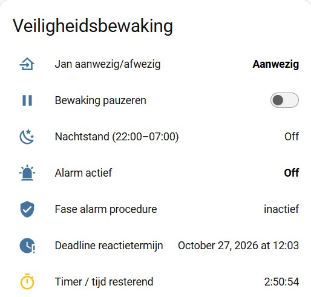

| 🇩🇪 Deutsch | 🇬🇧 English | 🇳🇱 [Nederlands](README.md) | 🇫🇷 Français | 🇪🇸 Español |
|:---:|:---:|:---:|:---:|:---:|

## Project Veiligheidsbewaking 
Zelfstandig wonen, met een beetje extra zekerheid. Zonder horloge, armband of noodknop houdt Home Assistant de dagelijkse activiteit in de gaten en stuurt het een melding als er mogelijk iets mis is.

  

## Hoe het idee ontstond

Ik kreeg de vraag van iemand die op leeftijd is en alleen woont (we noemen hem Jan). Jan wil geen horloge of alarmknop dragen om hulp in te roepen bij een val of plotselinge ziekte. De dichtstbijzijnde familie woont ca. 17 km verderop, en hij wil hen niet onnodig lastigvallen. Er wonen wel een paar vrienden in de buurt die, als het nodig is, even kunnen gaan kijken.

Er zijn plekken in het appartement waar Jan regelmatig langsloopt. En dat vormde het uitgangspunt voor deze automatisering.

Het idee: detecteert Home Assistant activiteit, dan start een timer van drie uur. Komt er binnen die tijd geen nieuwe beweging, dan vraagt het systeem of alles goed gaat. Blijft een reactie uit, dan worden contactpersonen één voor één gewaarschuwd. Tussen 22.00 en 07.00 uur staat de algemene bewaking uit.

Daarna is het idee uitgebreid met een extra controle voor de badkamer en het toilet. Juist daar wil je niet dat een mogelijk probleem onopgemerkt blijft.

## Wat heb je nodig?

- Home Assistant met automations, scripts en helpers.
- Twee bewegingsmelders op plekken waar de bewoner regelmatig langskomt. Dit is eenvoudig uitbreidbaar.
- Een bewegingsmelder én een deursensor in de badkamer.
- Een bewegingsmelder én een deursensor bij het toilet.
- Een telefoon waarop Home Assistant-meldingen binnenkomen.
- Meldingsdiensten voor de bewoner, de beheerder en maximaal drie contactpersonen.

Alle betrokkenen moeten toegang hebben tot hetzelfde Home Assistant-huis.
Zie [note](#note) onderaan deze pagina.

### Gebruikte sensoren

De gebruikte entity-ID's zijn voorbeelden uit de installatie van Piet. Pas ze aan jouw eigen sensoren aan.

- `binary_sensor.m_s_hal_beweging` en `binary_sensor.m_s_2_woonkamer_beweging`: de twee vaste looproutes.
- `binary_sensor.badkamer_beweging` en `binary_sensor.badkamer_deur`: bewegingsmelder en deursensor in de badkamer.
- `binary_sensor.toilet_beweging` en `binary_sensor.toilet_deur`: bewegingsmelder en deursensor bij het toilet.

### Meldingsdiensten en ontvangers

In deze versie zijn de notificaties als volgt verdeeld:

| Ontvanger | Meldingsdienst | Ontvangt |
|---|---|---|
| Jan (bewoner) | `notify.mobile_app_jan` | Bewonerscontrole, bevestiging wanneer een contactpersoon de melding opvolgt. |
| Piet (beheerder) | `notify.mobile_app_piet` | Ruimtemeldingen, definitief alarm als geen contactpersoon reageert en bericht wanneer een contactpersoon de melding opvolgt. |
| Contactpersoon 1 | `notify.mobile_app_contact1` | Escalatiemelding. |
| Contactpersoon 2 | `notify.mobile_app_contact2` | Escalatiemelding, als contactpersoon 1 niet reageert. |
| Contactpersoon 3 | `notify.mobile_app_contact3` | Escalatiemelding, als contactpersoon 2 niet reageert. |

De meldingsdiensten zijn afzonderlijk ingesteld, zodat iedere ontvanger alleen de meldingen krijgt die voor hem of haar bedoeld zijn. De beheerder ontvangt het definitieve alarm wanneer niemand de escalatie bevestigt.
Vervang de bovenstaande entity-ID's door de juiste meldingsdiensten in jouw installatie.

## De helpers

De helpers bewaren de status tussen automations en maken het systeem overzichtelijk.

| Helper | Functie |
|---|---|
| `input_boolean.veiligheidsbewaking_pauze` | Schakelt de bewaking tijdelijk uit, bijvoorbeeld bij vakantie of een dagje weg. |
| `input_boolean.veiligheidsbewaking_nachtstand` | Geeft aan dat de nachtstand actief is. |
| `input_boolean.veiligheidsbewaking_bevestiging` | Registreert dat de bewoner op de controle heeft gereageerd. |
| `input_boolean.veiligheidsbewaking_alarm` | Geeft aan dat de escalatieprocedure actief is. |
| `input_select.veiligheidsbewaking_fase` | Houdt bij in welke fase de procedure zich bevindt. |
| `input_datetime.veiligheidsbewaking_deadline` | Bewaart het tijdstip waarop de huidige reactietermijn afloopt. |
| `timer.veiligheidsbewaking_activiteit` | Wordt gebruikt voor de drie-uurscontrole en de kortere reactietermijnen. |

De keuzelijst `input_select.veiligheidsbewaking_fase` moet de volgende opties bevatten:

| Optie | Betekenis |
|---|---|
| `inactief` | Er is geen lopende controle of escalatie. |
| `controle_bewoner` | Er wordt op een reactie van de bewoner gewacht. |
| `contactpersoon_1` | Contactpersoon 1 is gewaarschuwd. |
| `contactpersoon_2` | Contactpersoon 2 is gewaarschuwd. |
| `contactpersoon_3` | Contactpersoon 3 is gewaarschuwd. |
| `alarm_onbevestigd` | Geen contactpersoon heeft de escalatie bevestigd. |

Controleer bij het instellen of de opties exact overeenkomen met de waarden die de scripts gebruiken.

Voor de badkamer- en toiletcontrole zijn in deze opzet geen extra helpers nodig. De afzonderlijke automations gebruiken een wachttijd van maximaal 30 minuten en roepen het script `script.veiligheidsbewaking_ruimtemelding` aan.

## Hoe werkt de algemene bewaking?

Bij beweging op een van de vaste looproutes start Home Assistant een timer van drie uur. Wordt er binnen die periode opnieuw beweging geregistreerd, dan begint de periode opnieuw.
Als er drie uur geen activiteit is geregistreerd, ontvangt de bewoner een controlebericht. De melding bevat een bevestigingsmogelijkheid waarmee de bewoner kan aangeven dat alles in orde is.
De reactietermijn van de bewoner bedraagt in deze versie vijf minuten. Als er geen bevestiging binnenkomt, begint de escalatie naar de contactpersonen.

### De procedure werkt als volgt

| Gebeurtenis | Wat Home Assistant doet |
|---|---|
| Drie uur geen beweging | Vraagt de bewoner om bevestiging en slaat de deadline op. |
| Bewoner bevestigt | Beëindigt de controle en start een nieuwe periode van drie uur. |
| Bewoner reageert niet binnen vijf minuten | Waarschuwt contactpersoon 1. |
| Contactpersoon 1 reageert niet binnen vijf minuten | Waarschuwt contactpersoon 2. |
| Contactpersoon 2 reageert niet binnen vijf minuten | Waarschuwt contactpersoon 3. |
| Contactpersoon 3 reageert niet binnen vijf minuten | Laat het alarm actief staan totdat er actie wordt ondernomen. Tevens melding naar beheerder.|
| Een contactpersoon bevestigt | Beëindigt de escalatie en start een nieuwe periode van drie uur. |
| Home Assistant herstart tijdens normale bewaking | Hervat de normale bewaking; de timer begint opnieuw met drie uur. |
| Home Assistant herstart tijdens een reactietermijn | Controleert de opgeslagen deadline en hervat de procedure. |
| Home Assistant herstart nadat een deadline is verstreken | Gaat direct door naar de volgende fase. |
| Bewaking wordt gepauzeerd | Stopt de timer en beëindigt een lopende alarmprocedure. |

Alle tijden zijn instelbaar. De drie-uursperiode, de reactietermijn van de bewoner en de termijnen voor contactpersonen kunnen dus worden aangepast aan de situatie.

### Wat gebeurt er bij een bevestiging?

Zodra de bewoner bevestigt dat alles in orde is, wordt de lopende controle beëindigd. De bevestigingsstatus wordt verwerkt en de reguliere bewaking begint opnieuw met een periode van drie uur.
Bevestigt een contactpersoon dat de situatie wordt opgevolgd, dan stopt de escalatie eveneens. Jan en Piet ontvangen hierover een bericht. Vervolgens wordt de reguliere bewaking hervat.
Als niemand reageert, blijft de fase `alarm_onbevestigd` actief. Piet ontvangt het definitieve alarm. Dit maakt duidelijk dat de procedure de laatste fase heeft bereikt en dat er nog geen bevestiging van een contactpersoon is geregistreerd.

Het definitieve alarm is daarmee een signaal dat menselijke opvolging nodig is. Het betekent niet automatisch dat hulp onderweg is.

## Nachtstand en pauze

Om 22.00 uur gaat de algemene bewaking in de nachtstand. Om 07.00 uur wordt de bewaking hervat en start een nieuwe timer van drie uur.

Om 09.00 uur vindt ook een dagelijkse controle plaats. Daarmee kan worden gecontroleerd of de bewaking nog naar behoren functioneert.

Met de helper `input_boolean.veiligheidsbewaking_pauze` kan de bewaking tijdelijk worden uitgeschakeld. 
Dit is bedoeld voor situaties waarin de bewoner bewust niet volgens het normale patroon aanwezig is, 
bijvoorbeeld tijdens vakantie, een dagje uit of een bezoek buitenshuis. 
Zo kan de bewoner er ook bewust voor kiezen om tijdelijk buiten de bewaking te blijven.
Bij het activeren van de pauze wordt de timer gestopt en een lopende alarmprocedure beëindigd. 
Na het hervatten moet de bewaking weer een nieuwe periode van drie uur starten.

## Automatisch pauzeren wanneer Jan het pand verlaat

Een aanvullende uitbreiding is het automatisch pauzeren van de veiligheidsbewaking wanneer Jan het pand verlaat met zijn smartphone en vergeten heeft om het systeem handmatig op pauze te zetten. 
Zodra hij terugkomt, wordt de bewaking automatisch hervat. Dit voorkomt dat het systeem contactpersonen waarschuwt omdat er geen 
beweging in het appartement wordt gedetecteerd terwijl Jan bewust van huis is.

### Hoe werkt het?

Home Assistant gebruikt de locatie van Jans smartphone om vast te stellen of hij zich binnen of buiten de ingestelde zone bevindt.
- **Jan verlaat het pand:** de veiligheidsbewaking wordt automatisch gepauzeerd.
- **Jan komt terug:** de automatische afwezigheidspauze wordt opgeheven en de bewaking wordt hervat, mits de nachtstand en een eventuele handmatige pauze dit toelaten.
- **Jan vertrekt tijdens een lopende alarmprocedure:** de lopende escalatie wordt beëindigd en de alarmstatus wordt teruggezet. Zo blijft er geen onbevestigd alarm actief dat uitsluitend is ontstaan doordat Jan het pand heeft verlaten.
Deze uitbreiding werkt naast de bestaande nachtstand en de handmatige pauzefunctie.

### Wat heb je hiervoor nodig?

1. **Locatiedetectie van Jans smartphone.** De Home Assistant Companion-app moet de locatie kunnen doorgeven. Sta hiervoor locatietoegang op de achtergrond toe en controleer de batterij- en achtergrondinstellingen van de telefoon.
2. **Een Home Assistant-zone voor het pand.** Meestal is `zone.home` geschikt, mits de locatie en de straal correct zijn ingesteld.
3. **De juiste locatie-entiteit.** Dit kan bijvoorbeeld `person.jan` zijn, als Jans smartphone aan deze persoon is gekoppeld, of rechtstreeks een entiteit zoals `device_tracker.sm_s721b`.
4. **Een aparte helper voor automatische afwezigheid.** Zo kan de automatische pauze worden opgeheven zonder een bewust ingestelde handmatige pauze uit te schakelen.

### 1. Maak een extra helper aan

Ga in Home Assistant naar Instellingen → Apparaten en diensten → Helpers → Helper aanmaken.

Maak de volgende helper aan:

| Instelling | Waarde |
|---|---|
| Naam | Veiligheidsbewaking afwezig |
| Entiteit-ID | `input_boolean.veiligheidsbewaking_afwezig` |

Deze helper registreert of de automatische afwezigheidspauze actief is.
De bestaande helper `input_boolean.veiligheidsbewaking_pauze` blijft uitsluitend bedoeld voor een handmatig ingestelde pauze. Beide functies blijven daarmee gescheiden.

### 2. Controleer de locatie-entiteit

Ga naar **Ontwikkelaarstools → Statussen** en zoek naar `person.jan` of de tracker van Jans smartphone.
Controleer of de entiteit daadwerkelijk bestaat en of de status verandert wanneer Jan het pand verlaat en terugkomt. Bij een persoonsentiteit moet de smartphone als locatiebron aan Jan zijn gekoppeld.
Gebruik in de automatisering de entiteit die in jouw installatie daadwerkelijk beschikbaar is.

### Aandachtspunten

Locatiedetectie is afhankelijk van de smartphone, de Home Assistant-app en de beschikbaarheid van locatiegegevens. 
Een vertraagde locatie-update kan ervoor zorgen dat het vertrek of de terugkomst niet onmiddellijk wordt geregistreerd.

Test daarom zowel het verlaten als het opnieuw betreden van de zone. 

Let er op dat het beëindigen van een alarm bij vertrek bewust is gekozen. 
Als Jan daadwerkelijk hulp nodig heeft en zijn telefoon desondanks buiten de zone terechtkomt, 
kan de procedure anders worden beëindigd dan bedoeld. 
Met deze uitbreiding kan de veiligheidsbewaking zich automatisch aanpassen aan de aanwezigheid van Jan, 
zonder dat een handmatige pauze of de nachtstand onbedoeld wordt opgeheven.

## Extra controle voor badkamer en toilet

Naast de algemene bewaking zijn er twee afzonderlijke controles: één voor de badkamer en één voor het toilet.
Deze controles zijn bedoeld om langdurig verblijf in een van deze ruimtes te signaleren. Ze staan los van de algemene alarmprocedure en starten niet automatisch de escalatie naar contactpersonen.

### Badkamer

Wanneer de bewegingsmelder in de badkamer beweging registreert, wacht Home Assistant maximaal 30 minuten op het openen van de badkamerdeur.
Gaat de deur binnen die tijd niet open en zijn de overige voorwaarden nog steeds van toepassing, dan wordt via `script.veiligheidsbewaking_ruimtemelding` een gerichte waarschuwing verstuurd.

### Toilet

De toiletcontrole werkt op dezelfde manier, maar gebruikt de eigen bewegingsmelder en deursensor.
De meldingen hebben afzonderlijke tags, zodat de badkamer- en toiletwaarschuwing onafhankelijk van elkaar herkenbaar zijn.

### Pauze en nachtstand

De badkamer- en toiletcontroles houden rekening met de pauzestand en nachtstand. Tijdens een pauze of de nachtstand worden geen waarschuwingen verstuurd.
Hierdoor blijft de ruimtebewaking afgestemd op de ingestelde gebruiksperiode van het systeem.

### Beperkingen van de ruimtecontrole

Een bewegingsmelder registreert beweging, maar kan niet vaststellen of iemand daadwerkelijk in de badkamer of op het toilet is gebleven. Een deursensor registreert alleen of de deur open of dicht is; hij bepaalt niet wie zich in de ruimte bevindt en evenmin in welke richting iemand beweegt.
Daardoor kunnen zowel gemiste meldingen als onterechte waarschuwingen ontstaan. De ruimtecontrole moet daarom worden gezien als een aanvullende signalering en niet als een betrouwbare vaststelling van een noodsituatie.

## Automations en scripts

De automations reageren op beweging, het verlopen van timers, bevestigingen, het pauzeren en hervatten van de bewaking, de nachtstand, de dagelijkse controle en een herstart van Home Assistant.

De scripts verdelen de acties in herkenbare onderdelen:

- `veiligheidsbewaking_controle`
- `veiligheidsbewaking_contactpersonen`
- `veiligheidsbewaking_start_contactpersoon`
- `veiligheidsbewaking_verwerk_deadline`
- `veiligheidsbewaking_contact_bevestigd`
- `veiligheidsbewaking_verstuur_huidige_melding`
- `veiligheidsbewaking_ruimtemelding`

Er is bewust gekozen voor losse onderdelen in plaats van één grote automation. Zo blijft zichtbaar wat er gebeurt en waarom. De scripts hergebruiken de logica voor de bewonerscontrole, de contactpersonen, de deadlines en de ruimtemeldingen. Dat maakt aanpassen en testen eenvoudiger.

### Herstel na een herstart van Home Assistant

Ook met een herstelprocedure moet rekening worden gehouden met een herstart van Home Assistant.
Tijdens de normale bewaking wordt na een herstart een nieuwe periode van drie uur gestart. Als er op dat moment een bewonerscontrole of escalatie loopt, controleert de herstelautomation de opgeslagen fase en deadline.
Is de deadline nog niet verstreken, dan wordt de resterende reactietijd opnieuw toegepast. Is de deadline al verstreken, dan gaat de procedure direct door naar de volgende fase.
De helper `input_datetime.veiligheidsbewaking_deadline` is hiervoor belangrijk. De timerhelper moet bovendien geschikt zijn voor herstel na een herstart. De herstelautomation en de timer moeten samen worden getest om te voorkomen dat een lopende procedure verloren gaat of een melding dubbel wordt verstuurd.

## Testen hoort erbij

Test de automatisering eerst met korte tijden en controleer de traces in Home Assistant.

Test minimaal de volgende situaties:

1. Normale bewegingscyclus: beweging start de timer en nieuwe beweging verlengt de bewakingsperiode.
2. Bewoner bevestigt: de controle stopt en een nieuwe periode van drie uur begint.
3. Bewoner reageert niet: contactpersoon 1 wordt na vijf minuten gewaarschuwd.
4. Contactpersonen reageren niet: de meldingen worden achtereenvolgens aan contactpersonen 2 en 3 verstuurd.
5. Een contactpersoon bevestigt: de escalatie stopt en Jan en Piet ontvangen een bericht.
6. Niemand reageert: het definitieve alarm wordt aan Piet verstuurd en de status blijft onbevestigd.
7. Pauzeren en hervatten: de timer en een eventuele alarmprocedure worden correct afgehandeld.
8. Nachtstand: de algemene bewaking en de ruimtecontroles reageren volgens de ingestelde voorwaarden.
9. Herstart van Home Assistant: zowel een lopende reactietermijn als een verstreken deadline wordt correct hersteld.
10. Badkamer en toilet: test beide controles afzonderlijk, inclusief het openen van de deur en de situatie waarin de deur dicht blijft.

Vervang vóór gebruik alle voorbeeld-entiteiten door de juiste entity-ID's en meldingsdiensten. 

## Disclaimer: een hulpmiddel, geen garantie

Een bewegingsmelder kan vaststellen dat iemand beweegt, maar niet dat diegene nog in orde is. Geen beweging betekent niet automatisch dat er iets mis is; iemand kan rustig zitten of slapen. Andersom bewijst recente beweging niet dat er daarna niets is gebeurd.
Ook de badkamer- en toiletcontrole kent beperkingen. Een deursensor registreert alleen open en dicht, niet of iemand naar binnen of naar buiten loopt. De huidige logica kan daarom een situatie missen of een onterechte waarschuwing geven.
Dit systeem is geen gecertificeerd alarmsysteem, vervangt geen professionele personenalarmering en garandeert niet dat hulp op tijd wordt ingeschakeld. Ook een definitief alarm betekent niet dat iemand daadwerkelijk hulp heeft ingeschakeld.
Gebruik dit als extra hulpmiddel, test het regelmatig en maak met de bewoner, beheerder en contactpersonen duidelijke afspraken over wie meldingen opvolgt.

---

## Licentie en gebruiksvoorwaarden

Deze automatisering mag vrij worden gebruikt en aangepast voor eigen gebruik.

Bij het publiceren, verspreiden of delen van deze deze automatisering, of van geheel of gedeeltelijk daarop gebaseerde aangepaste versies, is bronvermelding verplicht. Daarbij moet de oorspronkelijke auteur worden vermeld en moet, waar redelijkerwijs mogelijk, een verwijzing naar de oorspronkelijke repository worden opgenomen.

Het is niet toegestaan deze automatisering of afgeleide versies als volledig eigen oorspronkelijk werk te presenteren zonder de oorspronkelijke auteur te erkennen.

Deze automatisering wordt aangeboden zonder enige garantie. Gebruik en aanpassing geschieden op eigen risico. Voor zover wettelijk toegestaan aanvaardt de auteur geen aansprakelijkheid voor schade die voortvloeit uit het gebruik of de aanpassing ervan.

## *Note*
Om deze automatisering te kunnen gebruiken, moeten de betrokken personen op de juiste manier toegang krijgen tot de meldingen.
Dat klinkt misschien ingewikkelder dan het is. Niet iedereen weet hoe je een gebruiker toevoegt aan Home Assistant, de app installeert of de meldingsdienst op de juiste manier instelt.
Geen ervaring met deze instellingen? Geen probleem. Als daar behoefte aan is, ben ik best bereid om hiervoor een aparte handleiding op papier te zetten. Daarin kan stap voor stap worden uitgelegd hoe je gebruikers toegang geeft, de 2e Home Assistant-app installeert en de meldingen instelt en test.
Zo hoeft deze praktische drempel niemand ervan te weerhouden om met het project aan de slag te gaan.

